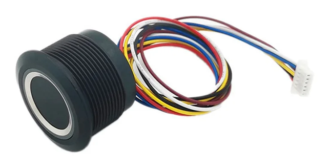

# ESPEasy plugin P190 – Fingerprint reader (Grow R503 / R307)

<p align="center">
  
</p>

[ESPEasy](https://github.com/letscontrolit/ESPEasy) plugin for the **Grow fingerprint modules** on a
serial port: R503 (round, with RGB LED ring), R307, R502, ZFM-20, AS608 and compatibles.

- Recognises a finger and sends its ID and score to the controllers and the rules
- Enrol, delete and count fingers with commands (from rules, HTTP or MQTT); enrolment can pick the first
  free slot by itself
- Enrolment progress as a task value, and JSON answers to HTTP commands: an enrolment page needs nothing
  but `/json` and `/control`
- R503 LED ring: automatic feedback (recognised / not recognised / enrolling) and a `led` command
- Touch detection on the WAKEUP pin, or polling when it is not wired
- Non blocking: the protocol runs as a state machine, ESPEasy keeps running while the module works

Built against ESPEasy `mega-20260720` on ESP32.

Plugin ID **190** is assigned by the ESPEasy maintainers ([letscontrolit/ESPEasy#5670](https://github.com/letscontrolit/ESPEasy/issues/5670)).
Versions up to October 2026 used ID 251: after updating, ESPEasy no longer recognises a task created with the old
ID, so add the task again with the same settings. The fingers stay stored in the module.

## Files

| File | Content |
|---|---|
| `src/_P190_Fingerprint.ino` | the plugin (settings page) |
| `src/src/PluginStructs/P190_data_struct.*` | state machine: scan, enrolment, commands |
| `src/src/PluginStructs/P190_protocol.*` | packet encoding / decoding, no ESPEasy dependencies |
| `test/test_protocol.cpp` | host unit tests of the protocol |

## Adding it to an ESPEasy build

1. Copy the `src/` folder of this repository over the `src/` folder of ESPEasy.
2. Enable the plugin in `src/Custom.h` of ESPEasy:
   ```c
   #define USES_P190   // Security - Fingerprint (Grow R503/R307)
   ```
3. Build a custom environment, e.g. `pio run -e custom_ESP32_4M316k`.

ESPEasy already has a slot for plugin 190, so no other file needs to be changed.

The [Build](.github/workflows/build.yml) workflow runs the unit tests and builds a small test firmware
(Switch, SysInfo, Dummy, P190) as the `espeasy-p190-test-firmware` artifact.

## Wiring (R503)

| Wire | | ESP32 |
|---|---|---|
| 🔴 Red | VCC **3.3 V** (not 5 V) | 3V3 |
| ⚫ Black | GND | GND |
| 🟡 Yellow | TX of the module | RX GPIO of the task (e.g. GPIO16) |
| 🟢 Green | RX of the module | TX GPIO of the task (e.g. GPIO17) |
| 🔵 Blue | WAKEUP: low while a finger touches the sensor | optional *Touch* GPIO (e.g. GPIO4) |
| ⚪ White | 3.3VT: power of the touch circuit | 3V3 |

With the *Touch* GPIO the module is only queried when a finger is on the sensor. Without it the
module is queried every *Scan interval* (default 250 ms).

The colors are those of the Grow datasheet. Some R503 clones differ: the one in the picture (the module
used to test this plugin, [from AliExpress](https://www.aliexpress.com/item/1005010295347958.html)) has a
🟤 **brown** (or dark red) wire instead of the green one for the RX of the module. If unsure, power only
red, white and black and measure the two data wires against GND: the TX of the module idles at about
3.3 V, the RX doesn't. Swapping TX and RX does no harm at 3.3 V, the module just doesn't answer.

When the module answers, the log shows `Fingerprint: module ready, 0 of 200 templates used` a few
seconds after the start. `Fingerprint: no answer from the module, check wiring and baud rate` means
TX/RX swapped, no power or a wrong baud rate; the plugin retries every 5 seconds.

## Settings

*Devices → Add → "Security - Fingerprint (Grow R503/R307)"*

| Setting | Default | |
|---|---|---|
| Serial port, GPIO RX / TX | – | hardware serial recommended. ESP32: RX/TX are filled in automatically when a HW port is selected (Serial0 3/1, Serial1 26/27, Serial2 16/17), and can be changed |
| Touch (WAKEUP) | – | optional input GPIO |
| Baud rate | 57600 | factory setting of the module |
| Password / Address | 0x00000000 / 0xFFFFFFFF | factory settings |
| Scan interval | 250 ms | only without the touch GPIO |
| Minimum score | 0 | lower scores are reported as not recognised |
| Show result on the LED ring | on | flashes twice in the *Recognised* (blue) or *Not recognised* (red) color |

The device page shows whether the module answers and how many of its slots are used (R503: 200).

### LED ring

With *Show result on the LED ring* on:

| When | Ring |
|---|---|
| finger recognised | 2 flashes in the *Recognised* color (default blue) |
| finger not recognised | 2 flashes in the *Not recognised* color (default red) |
| enrolment running | purple, breathing, from the start to the end: it doesn't change between "place" and "lift" (follow the `Enroll` value or the events for that) |
| enrolment stored | 3 flashes in the *Recognised* color |
| enrolment failed | 3 flashes in the *Not recognised* color |

Outside these moments the plugin doesn't drive the ring (`fingerprint,led` can). On the full RGB modules purple looks
pink / magenta.

## Values

| Value | |
|---|---|
| `ID` | slot of the recognised finger (0..199 on the R503), **-1** = not recognised |
| `Score` | match score from the module (higher = better) |
| `Count` | number of fingers stored in the module |
| `Enroll` | progress of the last enrolment, see below |

They are sent once per touch, when a finger is scanned: the rules get `<taskname>#ID`,
`<taskname>#Score` and `<taskname>#Count`. The module must see the finger lifted before it scans again.

`Enroll` is only updated, never sent: it is meant to be polled (`/json?tasknr=<n>&view=sensorupdate`,
value number 4) by pages or systems that don't get the rules events.

| `Enroll` | |
|---|---|
| 0 | no enrolment yet, or accepted and waiting to start |
| 1 | place the finger (capture 1) |
| 2 | lift the finger |
| 3 | place the finger again (capture 2) |
| 4 | merging and storing |
| 5 | stored |
| < 0 | failed: minus the error code (e.g. -254 = timeout), see below |

## Commands

| Command | |
|---|---|
| `fingerprint,enroll[,<id>]` | store a new finger at slot `<id>` (overwrites it), or without `<id>` at the first free slot: place, lift, place again |
| `fingerprint,list` | state of the module and the used slots, as JSON (see below) |
| `fingerprint,delete,<id>` | delete slot `<id>` |
| `fingerprint,deleteall` | delete all fingers |
| `fingerprint,count` | read the number of stored fingers (event `#Count`) |
| `fingerprint,led,<mode>,<color>[,<speed>[,<times>]]` | LED ring, see below |
| `fingerprint,cancel` | stop an enrolment |

LED ring: `<mode>` = `breathing`, `flash`, `on`, `off`, `fadein`, `fadeout` (or 1..6), `<color>` =
`red`, `blue`, `purple`, `green`, `yellow`, `cyan`, `white` (or 1..7; green to white need the full RGB
R503), `<speed>` 0..255 (default 100), `<times>` 0..255 (0 = forever, default).
Example: `fingerprint,led,breathing,blue`.

Commands reach every P190 task: use a single P190 task per ESP. Only one enrolment at a time: a second
`enroll` is refused while one is queued or running.

From HTTP (`/control?cmd=...`) two commands answer with JSON:

| Command | Answer |
|---|---|
| `fingerprint,enroll[,<id>]` | `{"enroll":3}` (slot used) or `{"error":"no free slot"}` |
| `fingerprint,list` | `{"ready":true,"capacity":200,"count":2,"enroll":5,"slot":3,"used":[0,3]}` |

`enroll` and `slot` in the list are the state and the slot of the last enrolment. `used` is `null` if the
module can't list its slots (ReadIndexTable): then `enroll` needs an `<id>`.

ESPEasy appends its own `OK` to the output of every plugin command it ran, so the HTTP body is e.g.
`{"enroll":3}OK`: parse from the first `{` to the last `}`. Without P190 in the firmware the answer is
`Command unknown: ...`; an older version of the plugin answers only `OK`. `delete`, `deleteall`, `cancel` and `led` answer only `OK`: their result
comes later (event or `list`).

**`/control` and `/json` don't ask for the ESPEasy admin password.** Anyone who can reach the ESP can enrol
a finger, also over the slot of an authorised person. Limit the clients with *Config → Client IP filtering*
(e.g. *Allow IP range*) or keep the ESP in a network only trusted devices can reach.

## Events

| Event | |
|---|---|
| `<taskname>#EnrollScan=<n>` | enrolment: place the finger (capture `<n>` = 1 or 2) |
| `<taskname>#EnrollRemove=<n>` | enrolment: lift the finger |
| `<taskname>#Enrolled=<id>` | enrolment done |
| `<taskname>#EnrollFailed=<code>` | enrolment failed, see the codes below |
| `<taskname>#Deleted=<id>` | slot deleted, -1 = all |
| `<taskname>#Count=<n>` | answer to `fingerprint,count` |
| `<taskname>#Error=<code>` | `delete`, `deleteall`, `count` or `led` failed |

Error codes: `10` the two captures are not the same finger, `11` slot out of range, `24` flash
error, `252` no free slot, `253` cancelled, `254` no finger placed / lifted within 20 s, `255` no answer from the module.
Other values are confirmation codes of the module (see its datasheet).

## Rules example

Task named `Finger`, opening a door relay on GPIO26 for 2 seconds for fingers 0..9:

```
on Finger#ID do
  if %eventvalue1% >= 0 and %eventvalue1% < 10
    Pulse,26,1,2000
  endif
endon

on Finger#EnrollScan do
  LogEntry,'Place the finger (%eventvalue1%/2)'
endon

on Finger#Enrolled do
  LogEntry,'Finger stored at %eventvalue1%'
endon
```

Enrol from the browser: `http://<esp-ip>/control?cmd=fingerprint,enroll` (first free slot) or
`http://<esp-ip>/control?cmd=fingerprint,enroll,0`.

## License

Like ESPEasy, this plugin is released under the [GNU General Public License v3.0](LICENSE)
(or, at your option, any later version).
